# Arnis 3.5.0 "Confluence"

This is a fork release (Teddy563/arnis) built on upstream v3.4.0 and merged with upstream `main` (Live mode). Every new flag is off by default. With no new flag and the Meld features switch off, Arnis writes the same world as stock (the One World seam fix is the one exception, see Phase 0).

Contents: [Phase 0](#phase-0-the-large-world-foundation) / [Phase 1](#phase-1-meld-features-as-cli-flags) / [Phase 2](#phase-2-the-gui) / [Phase 3](#phase-3-translations) / [Phase 4](#phase-4-merge-with-upstream-main-live-mode) / [Known limitations](#known-limitations) / [Verification](#verification)

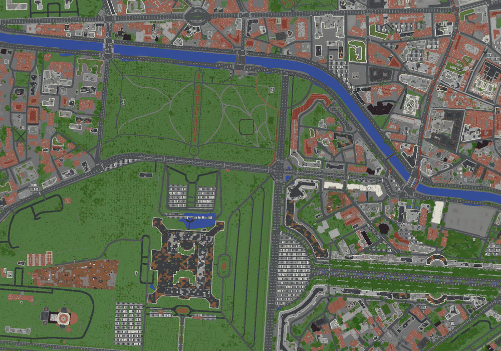

## Phase 0: the large-world foundation

The later phases build on this. Apart from the seam fix, none of it changes output unless you ask.

- **NDJSON progress.** `--progress json` also prints one JSON object per line on stdout (`{"v":1,"type":...}`): phases, progress, per-piece records, errors and a final `done` line with chunks, CPU seconds, peak memory and wall time. It is for programs that drive the CLI.
- **Capabilities.** `--capabilities` prints one line, a JSON array of every long flag this build knows, and exits. A driver can probe before it passes a flag.
- **Machine knobs.** `--threads`, `--cpu-target` (percent of cores), `--ram-budget-mb` (memory this run may assume), `--max-downloads` (downloads in flight, default 16), `--no-update-check` and `--no-cache-sweep`. These let several Arnis processes share one machine.
- **One World seam fix.** A building that straddles the edge between two One World areas used to pick a different floor on each side. The clip pad grows from 64 to 128 blocks and the elevation and land-cover frame now follow it. Measured on the Bucharest parity area, one run against the same area built as two adjacent areas: stock v3.4.0 differs by 4,545 blocks in 116 chunks; 3.5.0 differs by 998 blocks in 49 chunks, and the floor band is gone. What remains is leaves, grass and facade colour. The fix is not behind a flag, so a flags-off One World differs from stock in those seam blocks (see Verification).
- **Work units.** `--plan-units N` prints how `--one-world` would cut `--bbox` into pieces of at most N x N regions (one JSON line) and exits without touching caches or the network. `--unit-regions N` sets the piece size. `--one-world-unit` builds one piece.
- **Parallel coordinator.** `--one-world-workers auto|N` builds a One World in pieces, N at once, each in its own process, sharing the job's threads, memory and downloads. `auto` picks 2 to 6 from free RAM and cores. A killed job resumes where it stopped, and `--only-pieces N,N` rebuilds named pieces. The GUI pauses and stops a job; from a shell, end the process.
- **Map ids.** Each piece gets its own range of map ids, so signage decals and map items stay unique across pieces. The counter only moves up.
- **Piece halo.** Neighbouring pieces overlap, so a job in pieces matches one run more closely. On the parity area, 4 pieces against one run: 3,388 blocks (183 chunks) before the halo, 639 blocks (139 chunks, about 67 of them differing only in decal map ids) after. Pieces built one at a time and four at a time are identical (0 differing chunks).

## Phase 1: Meld features as CLI flags

Each track lists every flag, then anything v3.4.0 already did that was left out.

### Data

| Flag | What it does |
|---|---|
| `--osm-pbf PATH\|geofabrik` | Read OSM from an `.osm.pbf` file, or from the smallest Geofabrik region that covers the area, instead of the tile archive. |
| `--osm-pbf-url URL` | The extract to download for `--osm-pbf geofabrik`. |
| `--osm-tiles-url FOLDER` | Existed for a remote archive. It now also takes a local folder or `file://` path holding an arnis-tiles archive. |
| `--overpass-url URL` | Your own Overpass server(s), tried in order (comma list, or env `ARNIS_OVERPASS_URL`). |
| `--offline` | Never use the network. Read the caches, and stop with a list of what they lack (env `ARNIS_OFFLINE`). |
| `--prewarm` | Download and cache everything this command would read for `--bbox`, then exit without writing a world. |
| `--prewarm-first` | With `--unit-regions`, warm the caches of every piece, one at a time, before the pieces build. |

The `.pbf` reader uses the same query v3.4.0 sends to Overpass, and a test checks that both paths give the same elements. Offline mode hooks every download point (Overpass, tile index and ranges, elevation, land cover, canopy, Overture, 3D models) and removes the fresh world if something was missing. `ARNIS_CACHE_ROOT` moves all caches. One new crate: `osmpbf` 0.3.8.

Already in v3.4.0, so not redone: the remote OSM tile archive and its cache, the Mapterhorn 404 markers (one extension: a `--prewarm` run proves the network once so absent tiles replay offline), and `--no-update-check`, `--no-cache-sweep` and `--max-downloads` (Phase 0).

### Output

| Flag | What it does |
|---|---|
| `--region-format mca\|blinear` | EXPERIMENTAL. `blinear` writes Leaf 1.21.11+ and 26.x B_Linear regions. |
| `--blinear-level N` | zstd level for B_Linear, 1 to 22 (default 6). |
| `--origin LAT,LON` | Latitude and longitude of block (0, 0) in a new One World. An existing world keeps its origin. |
| `--world-border` | Java only: set the world border around the generated area (a One World: around all its areas). |
| `--map-item-only` | Redraw the map item of a One World from its area previews and exit. |
| `--dh-lod-only` | Rebuild the Distant Horizons LODs of a One World from its region files and exit. |

Nothing was dropped: v3.4.0 had no B_Linear, no origin pin, no border and no way to rebuild LODs from an existing world. `--dh-lod-only` recomputes lighting instead of reading it, and takes the world's session lock. B_Linear is refused with Bedrock, Luanti, `--one-world`, `--voxy-lod` and `--dh-lod`.

### Terrain

| Flag | What it does |
|---|---|
| `--river-bed off\|v1` | `v1` gives rivers, canals and streams a smooth U-shaped bed that deepens with width. Lakes and the sea keep their bed. |
| `--water-detail default\|scaled` | `scaled` rounds bed depths and, on small maps, carves narrow bodies as bowls, narrows streams and lets water flow over roads that are not bridges. |
| `--climate-mode origin\|per-position` | EXPERIMENTAL. `per-position` reads the Koppen climate and biome latitude at every block, so a large world crosses climate zones. |
| `--climate-map PREFIX` | EXPERIMENTAL. Render the per-position climate layout of `--bbox` to `PREFIX.png` and exit. |
| `--min-y Y`, `--max-y Y` | Lowest and highest Y of the extended-height world. They need `--disable-height-limit`. |
| `--seed N` | EXPERIMENTAL. World seed mixed into every per-element random choice (trees, rocks, flowers, building variety). 0 or omitted keeps stock output. A One World keeps the seed of its first area. |

The bed and detail flags only deepen where land cover says there is water. A map with no water keeps its ground datum, so those flags change nothing there. River beds respect tunnels under water.

Left out: the fork's `--snow-mode` family (it moves the natural snow line, and `--winter` already covers the winter look). Already in v3.4.0: the data-pack writer for tall worlds, which now reads its range from `--min-y` and `--max-y`.

### Nature

| Flag | What it does |
|---|---|
| `--rocks`, `--rock-density F` | Scatter small andesite and tuff rocks over open grass and cropland. Density is the share of 16x16 chunks, default 0.02. |
| `--bushes`, `--bush-density F` | The same for bushes of ten species. Default 0.05. Where a chunk rolls both, the rock wins. |
| `--tree-realm REALM` | Force a tree realm (afr, asn, aus, ena, eur, fl, ind, sam, wna, vanilla-plus) instead of picking one from the location. |
| `--tree-size-weights LIST` | Relative popularity of tree sizes, for example `big=150,tall=50,giant=0`. 0 turns a size off. |
| `--tree-pack-dir FOLDER`, `--tree-pack-mode add\|replace` | EXPERIMENTAL. Use your own tree schematics, added to the bundled ones or replacing them. |
| `--init-tree-pack-dir FOLDER` | Create the empty pack layout and exit. |
| `--export-tree-packs FOLDER` | Write every bundled tree schematic in that layout, to edit, and exit. |
| `--cave-style vanilla\|more-vanilla\|all-mix\|more-mix` | How much of the underground the themed cave biomes take (default `all-mix`, about 77 percent). |
| `--cave-ores normal\|more` | `more` doubles the veins of every metal and gem ore. |
| `--cave-seed N` | Seed for the cave layout. |
| `--cave-datum-y Y` | Y that stands for vanilla's world floor in the cave passes, so caves line up across runs. |

Rocks and bushes roll per chunk from world coordinates, so splitting an area into pieces does not change them. A One World stores its cave seed and datum from the first area, adopts them later, and refuses a different value. 68 rock and bush schematics are bundled.

Differences from the fork: v3.4.0 sizes trees by height, so the size weights reweight the five height bands instead of rolling a size. `--cave-seed` is independent of `--seed`. Nothing in this track was already in v3.4.0.

### Build

| Flag | What it does |
|---|---|
| `--road-detail max\|clean\|compact` | How much road marking and how many minor ways to build. `clean` keeps centre lines and 2-block crossing bars. `compact` also drops footways, paths and service roads. |
| `--no-buildings` | Leave out buildings, parts, doors and Overture footprints. Roads, rail, water, land cover and terrain stay. |
| `--props LIST` | Which 3D props to place: `all`, `none`, or a list (boat, car, crane, and so on). |
| `--props-min-scale F` | Leave out every schematic prop below this world scale. |
| `--loot-table FILE` | Chest loot table (JSON) for `--interior`. A bad file is reported and the built-in table is used. |
| `--dump-loot-table FILE` | Write the built-in table to FILE and exit. |

The built-in table rolls the same chests as v3.4.0 (a test pins all five themes). Left out: the fork's field texture and road-bearing module (v3.4.0's `--fields` replaces them), and the fork's on/off schematic switch (replaced by the prop list). `--props` does not govern external 3D models, which still follow `--no-3d`.

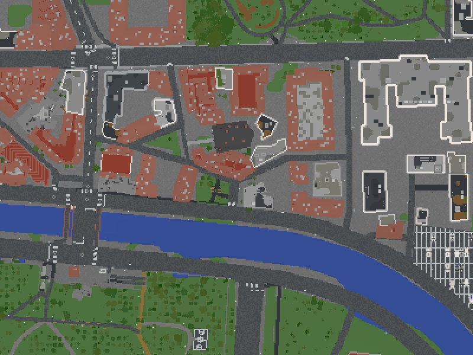

## Phase 2: the GUI

By default the window looks the same as stock.

**Meld features switch** (Advanced). Off, the window shows only stock settings and sends no new flag. On, the extra controls appear.

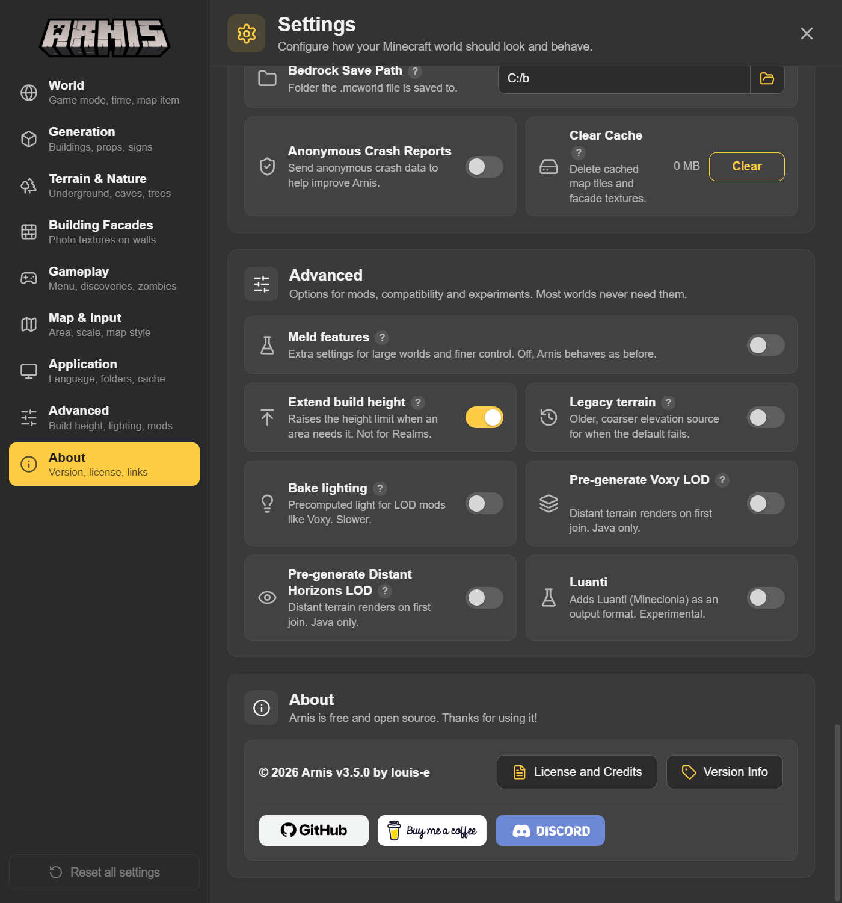

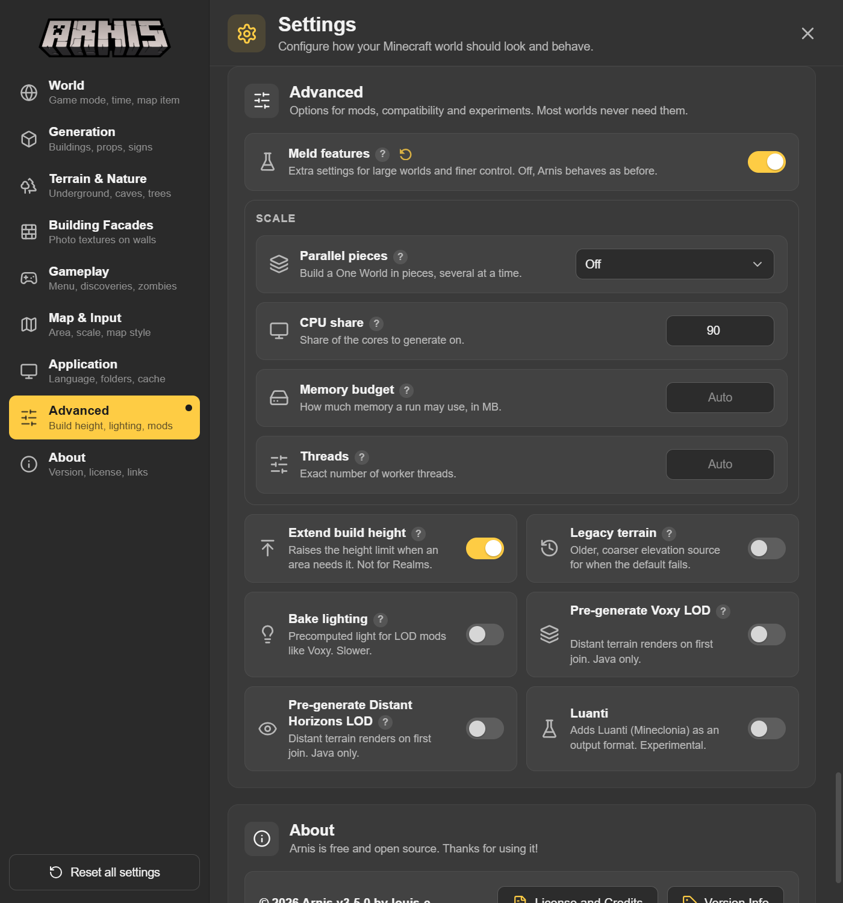

**Run controls.** A large area can run in pieces. Each piece is outlined on the map and shows its state. Pause and Resume hold the queue, Stop ends the job, and Retry pieces rebuilds the ones that failed or never started, using `--only-pieces`. Each outline shows the piece number, a state icon and its percent; hovering shows the worker, elapsed time and the first line of any error. A line under the controls counts done, running and failed pieces. Clicking a failed or stopped piece retries only that piece. A retry is refused if the area or world changed since the job started.

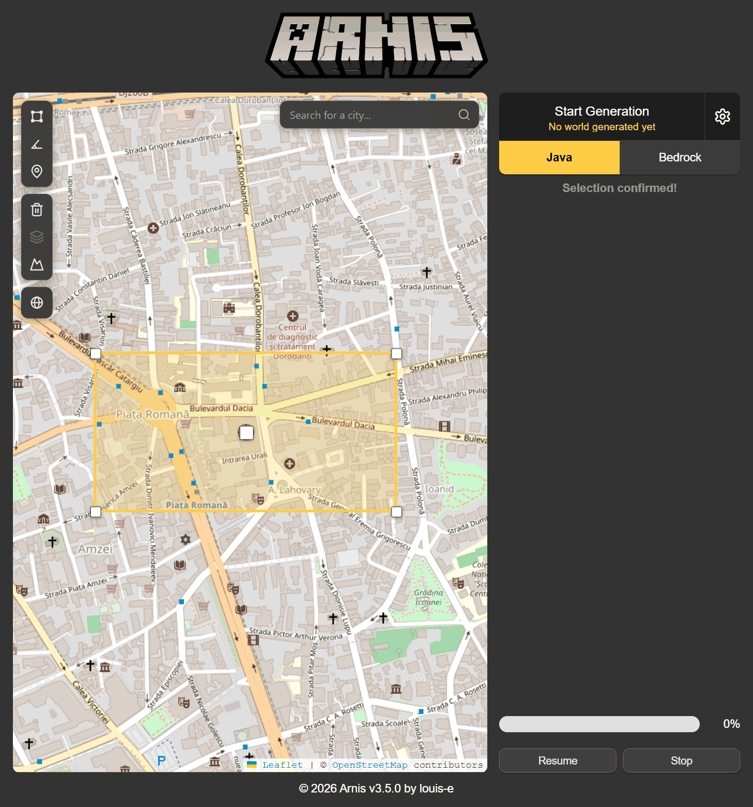

**Data panel** (World). OSM Data Source (Default, Local Archive (Experimental), Region Download), archive folder, extract URL, Overpass server, Offline Mode, Prepare Countries (check, download and bake, stop) and Download Plan.

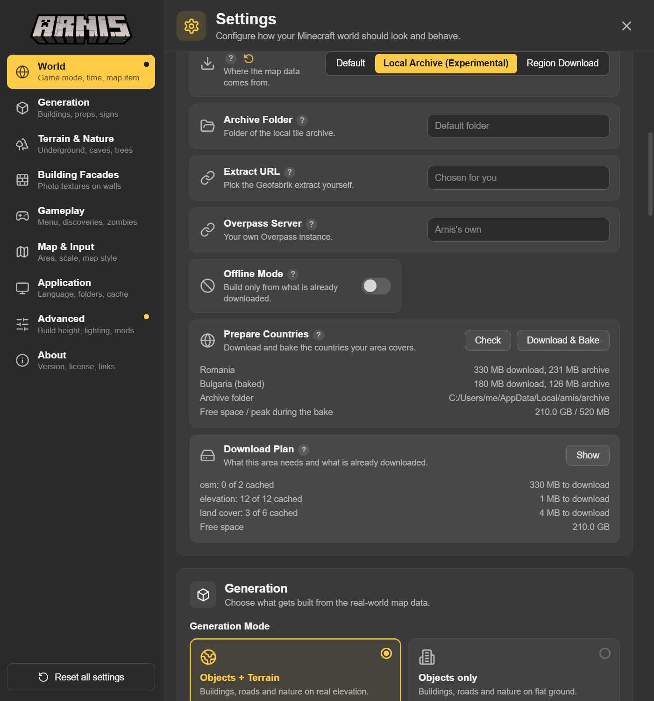

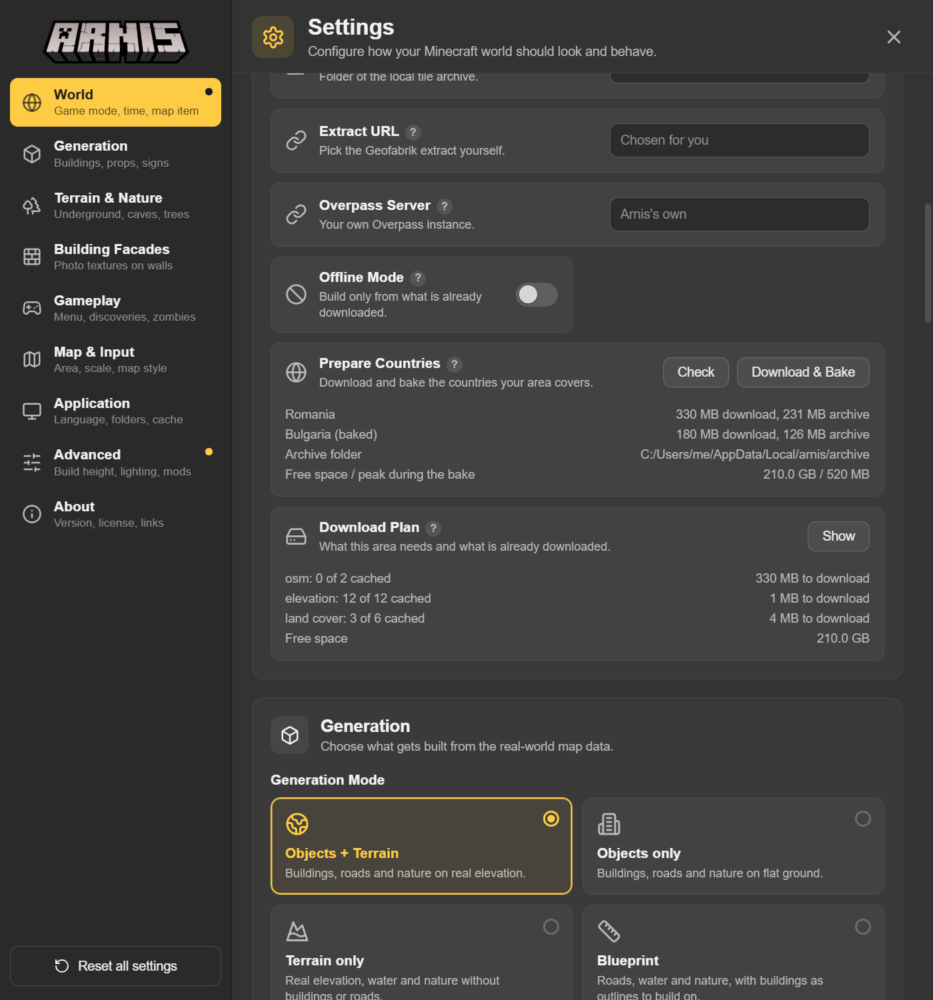

**Settings in their sections.** Each new setting sits next to the stock ones it belongs with: world and data in World, rocks, bushes, trees and caves in Nature, and so on.

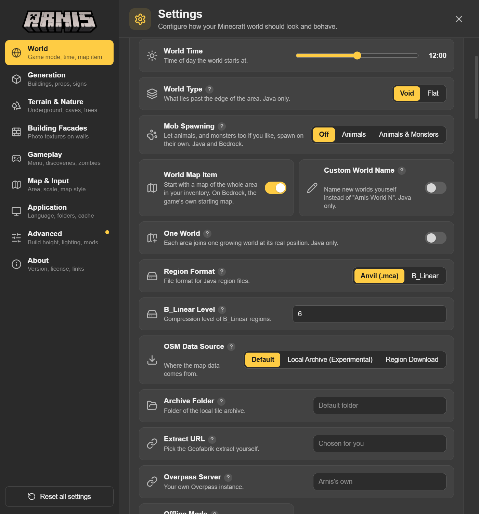

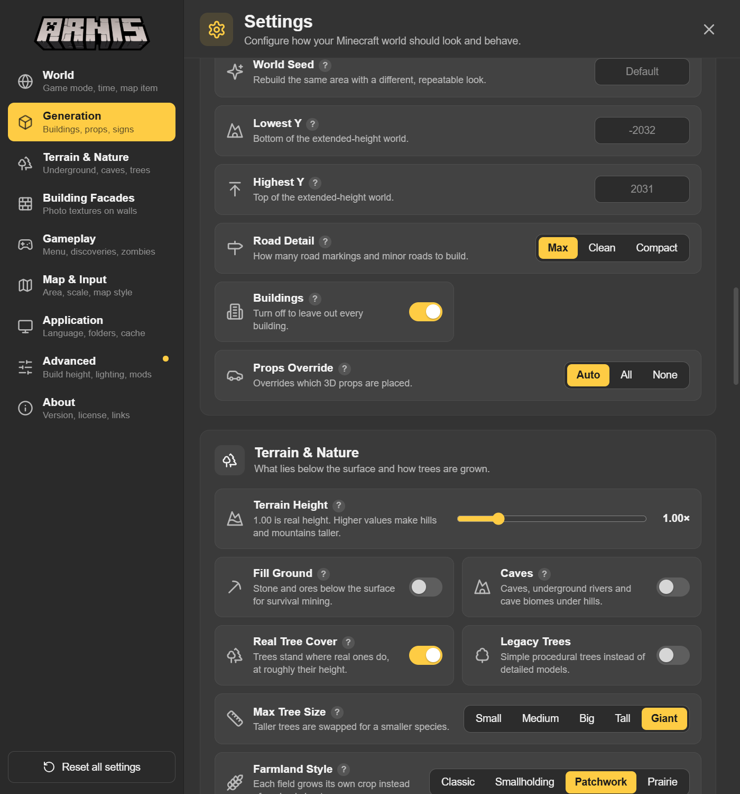

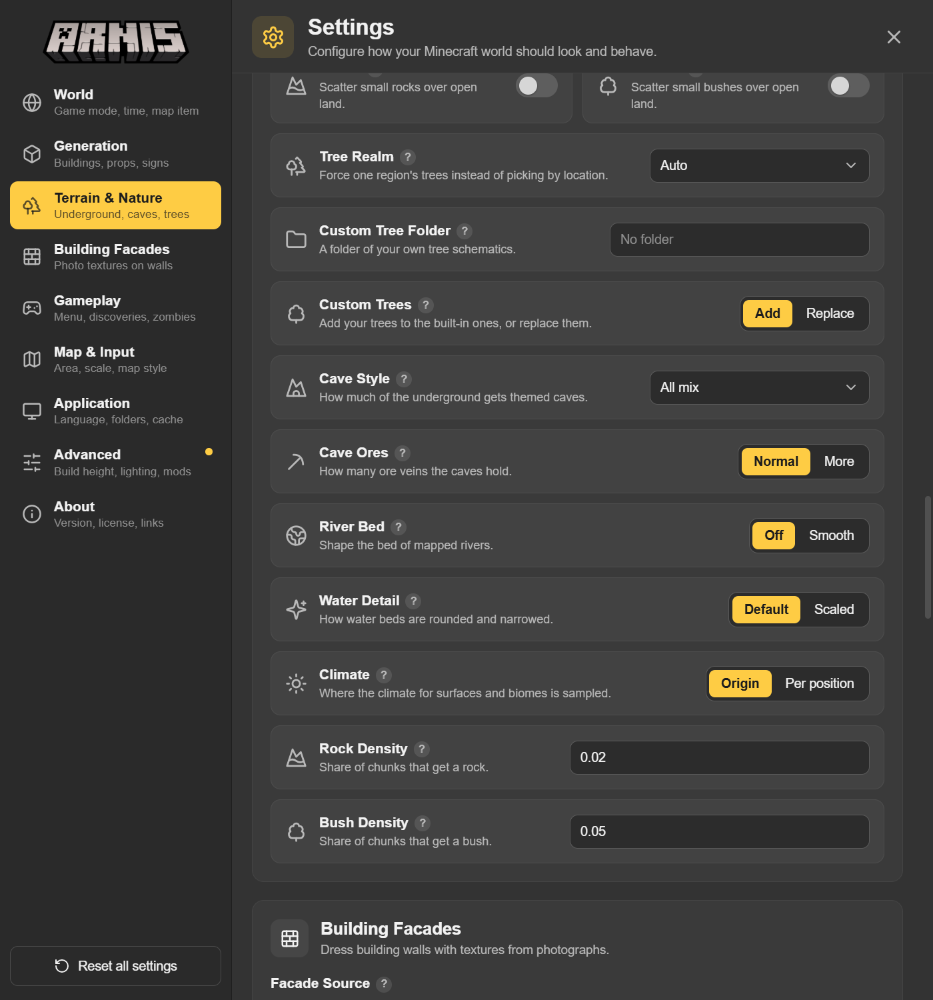

The window builds the same arguments as the CLI and runs them through the CLI's own parser. Only an allow-list of flags can come from the page, and numbers are checked before a world is created. Not in the window: `--max-downloads`, `--tree-size-weights`, `--props-min-scale` and a picker for the tree folder.

## Phase 3: translations

The new strings (about 147 keys, tooltips included) are translated into all 19 locales besides en-US, so the GUI's 20 locales are covered: ar, de, en-US, es, fi, fr-FR, hu, ja, ka-GE, ko, lt, lv, pl, pt-BR, ro, ru, sl, sv, ua and zh-CN. Romanian had its own translation pass. The ka-GE, lt, lv and hu translations, and the Japanese and Korean terms for "props", want a check by a native speaker.

## Phase 4: merge with upstream main (Live mode)

Upstream `main` (Live mode, vehicles, stations, race tracks, golf and stadiums) is merged in. 11 files conflicted. Every line the fork added was checked against the merged result.

- `--live` together with `--one-world-workers` other than 1 is refused: "--live builds the One World one tile at a time; leave out --one-world-workers."
- Debug builds overflowed the 1 MB Windows main-thread stack while parsing the roughly 200 flags (even `--capabilities` crashed). The CLI now runs on an 8 MB thread. Release output is unchanged. This also made `tests/offline.rs` runnable again.
- The CLI entry point follows upstream's split into live and generation paths.

## Known limitations

- **Live mode from the window ignores the Meld features panel.** The CLI refuses `--live` with any 3.5.0 flag; the window's Play Live button starts stock Live mode and does not pass the Meld settings.
- **Local archive is experimental.** The arnis-tiles baker writes the older AOT1 format. A local archive of the Bucharest area held 8,865 elements where the public AOT2 archive has 16,462, so worlds from it are sparser. The reader is fine. An AOT2 baker in arnis-tiles is the follow-up. The GUI labels it "Local Archive (Experimental)".
- **Live mode was verified only up to the EULA prompt.** The check stopped there because `--accept-eula` accepts Mojang's EULA on the user's behalf. A single Live tile was run by hand (see Verification).
- **Live mode refuses the new flags.** Live tiles build with upstream's settings only, so `--live` refuses every 3.5 flag its tiles would drop and names each one. That covers the water, climate, scatter, tree, cave-style, road, building, prop, data-source, output, piece and machine flags. `--offline` is not supported in Live mode. `--seed`, `--cave-seed` and `--cave-datum-y` are allowed because they travel in the world's manifest.
- **Gameplay extras are refused in a job built in pieces.** `--traffic-lights`, `--discoveries`, `--pause-menu`, `--zombie-outbreak`, `--disasters`, `--moving-vehicles` and `--body-gravity` install one datapack for the whole world, which pieces would overwrite. Use them without `--one-world-workers` and `--unit-regions`.
- **A GUI four-piece job was not run by hand.** The window was tested with a stubbed backend: switch, flags, outlines, Pause, Stop and Retry. A real piece job started from the window needs one manual run.
- **B_Linear is not available with One World.** There is no B_Linear reader or merge path. Convert a One World afterwards with Meld's region-convert.
- **Piece-versus-single residual.** A job in pieces still differs from one run by about 639 blocks on the parity area: facade colour picks that depend on an area-wide input (about 535 blocks), sea lanterns (87) and decal map ids.
- **Seam residual.** 998 blocks (leaves, grass, facade colour) remain across an area edge. A One World started with 3.4.0 and extended by 3.5.0 keeps its seam at the old edge, because the manifest version is unchanged.
- **Map item of a fresh parallel job** shows the first piece only, since piece previews are not stitched. Redraw with `--map-item-only`.
- **Map id reservation** is never released, so each finished job uses pieces x 65,536 ids (room for about 32,000 pieces).
- **Water flags raise the ground floor** by a block or more where a map has water. A river that land cover does not mark as water gets no bed.
- **Climate.** `--climate-mode per-position` refuses `--rotation`, and natural and building colours still read the origin climate.
- **Seed and caves.** `--cave-seed` does not follow `--seed`.
- **Y limits** are refused with One World, Bedrock and Luanti.
- **`--origin`** is checked by a unit test and a smoke run, not by a block-for-block content comparison.
- **Snow line** control from the fork was not ported.
- **Single GUI runs have no Stop.** Stop only applies to jobs in pieces.
- **Offline mode** skips Mapillary and facade jobs, with a note.

## Verification

**Parity method.** Flags off must equal stock. The Bucharest parity area (`--bbox 44.4450,26.0950,44.4480,26.1030`) is built twice, plain and as a One World (a seed area, then the extension), and compared chunk by chunk after dropping `LastUpdate` and `InhabitedTime`. Every Phase 0 task and every track passed this gate before it was merged.

- Before the upstream merge: 0 of 840 plain chunks and 0 of 880 One World chunks differ from the baseline.
- After the merge: plain is 0 of 840 against stock upstream `main`. One World is 320 of 880 against stock `main`, all from the seam fix, and 0 of 880 against the seam-fixed baseline. Two renders by the merged build are identical.
- With river-bed and water-detail on, the parity area (no water in its land cover) also gives 0/840 and 0/880. With `--seed 7` the world differs on purpose.

**Tests.** `cargo test --all-targets --all-features` on the release branch: 2,427 unit tests pass, 24 are ignored and 1 fails on Windows only (`locales_match_en_us_keys`, because `en.json` is a symlink that Windows does not create). The Wave 0 exit run had 2,176 passing. Integration tests run with `--no-fail-fast`, and `tests/offline.rs` passes. Run by hand with their environment: resume after a killed piece (880 of 880 chunks equal, twice), prewarm then offline equals online (0 differing chunks), and pieces against a single run within the stated residual. `cargo fmt --check` and `cargo clippy --all-targets --all-features -D warnings` are clean. `node tests/gui/meld-flags.mjs` confirms the switch sends no flag when off.

**Live tile.** One Live tile was run by hand without the server or the EULA. It was an `--one-world --live-tile` run of region 0,0 into a staging copy of a small One World, flags off and again on a `--seed 7` world with an empty cache. Each took about 3 s (the deadline is 600 s), wrote 1,024 chunks into `r.0.0.mca` only, created no neighbour region, and recorded its area in the staging manifest.

**Smoke runs.**
- All flags on, One World, 2 workers, 1-region pieces, prewarm first: finished, 4 regions, border set. Flags: `--river-bed v1 --water-detail scaled --climate-mode per-position --seed 7 --rocks --bushes --tree-realm eur --caves --cave-style more-mix --cave-ores more --cave-seed 3 --road-detail clean --world-border`.
- `--live --one-world --one-world-workers 2` is refused. `--live --one-world` stops at the EULA prompt.
- Single-flag renders on the parity area: B_Linear (plain and flat), origin with border, `--map-item-only`, `--dh-lod-only`, `--osm-pbf` on a fixture, `--offline` with a warm cache, `--prewarm` (no world written).
- Preview renders for these notes: Bucharest by the Dambovita, `--bbox 44.425,26.08,44.435,26.10`, once stock and once with `--river-bed v1 --water-detail scaled --rocks --bushes --road-detail clean --caves`. The top-down preview shows land and water but not bed depth, so the two look alike at this size. A four-piece build of the parity area (`--one-world-workers 2 --unit-regions 1`) is shown with its pieces stitched and outlined.

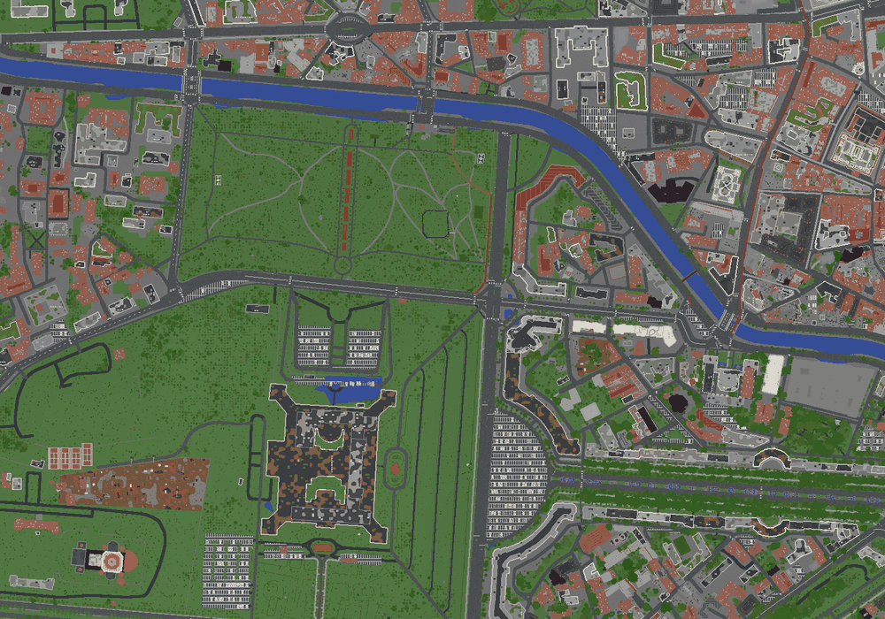

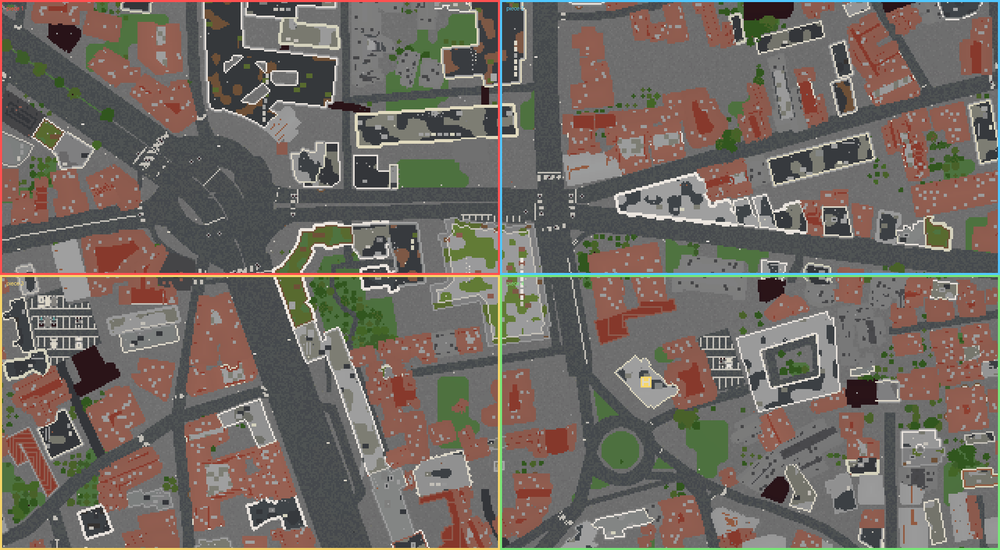
